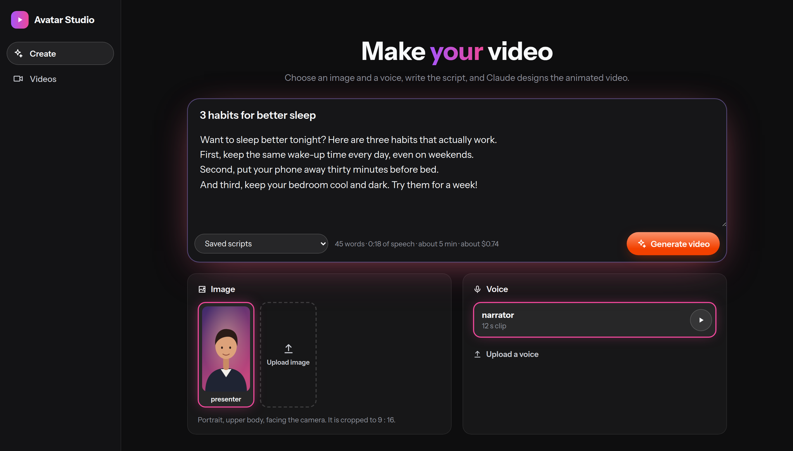
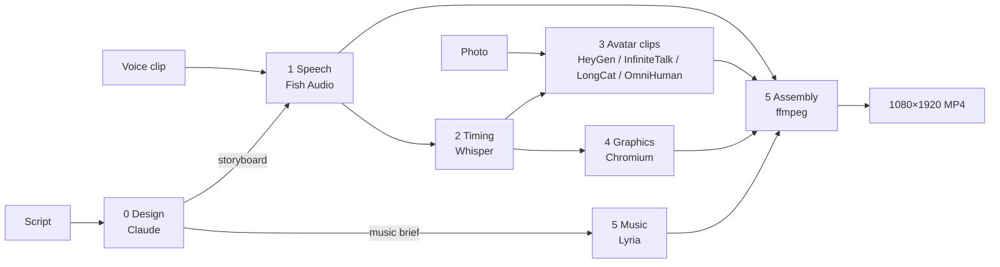

# avatar_pipeline

Turns a script, a photo and a voice clip into a 1080×1920 video of that person presenting it, with
animated graphics, captions and background music. All AI models run in the cloud; no GPU needed
(an optional local avatar model uses one).





| Step | Model | Script |
|---|---|---|
| 0 Design | Claude Opus 5.5 (Anthropic API) | `src/reel/write_storyboard.py` |
| 1 Speech | Fish Audio S2.1 Pro (OpenRouter) | `src/reel/clone_voice.py` |
| 2 Timing | Whisper (OpenRouter) | `src/reel/timing.py` |
| 3 Avatar clips | HeyGen Avatar 6 Turbo (OpenRouter), InfiniteTalk / LongCat Avatar 1.6 (WaveSpeed), OmniHuman 2.0 (fal.ai) or LongCat on a local GPU | `src/reel/render_face.py` |
| 4 Graphics | headless Chromium | `src/reel/render_visuals.py` |
| 5 Music + assembly | Lyria 3 (OpenRouter), ffmpeg | `src/reel/make_music.py`, `src/reel/assemble.py` |

A 30 s reel takes about 5 minutes and costs about $1, mostly HeyGen ($0.05 per second the avatar is on screen).

## Setup

Needs Linux and conda.

```bash
cp .env.example .env && chmod 600 .env    # fill in ANTHROPIC_API_KEY and OPENROUTER_API_KEY (WAVESPEED_API_KEY, FAL_KEY optional)
bash src/setup/setup.sh                   # builds env/reel
```

## Usage

Web app: see [webapp/README.md](webapp/README.md).

Command line:

```bash
REF_AUDIO=inputs/voice/voice.wav REF_TEXT=inputs/voice/voice.txt \
  bash src/make_video.sh <name> inputs/scripts/<name>.txt inputs/photo/template.json
# → outputs/reels/<name>/<name>.mp4
```

- **Script**: plain text, one paragraph per line.
- **Voice**: `REF_AUDIO` is 10–20 s of clear speech (wav); `REF_TEXT` is its exact words. If the text
  file is missing, Whisper writes it.
- **Photo template**: `{"cond_image": "inputs/photo/portrait.png", "prompt": "<describe the person and setting>"}`.
  A 9:16 portrait works best.

Re-running reuses what already exists (design, speech, avatar clips, music), so a retry only redoes
what is missing. Set `FORCE_FACE=1` to remake the avatar clips.

`AVATAR_ENGINE` picks the avatar model: `heygen` (default, 1080p, $0.05/s), `infinitetalk` (480p, $0.03/s),
`longcat` (480p, $0.04/s), `omnihuman` ($0.105/s) or `longcat-local` (720p, free; see below). The list,
with each model's provider, price and key, is `src/reel/avatar_engines.json`; the web app reads it too.
Claude writes a hand and body `gesture` for every on-camera beat, which is added to the photo's prompt.
The gesture rule Claude follows, and the constraints added to every avatar prompt (the person and their
bare hands look the same in every clip), are in `src/reel/avatar_rules.json`.

Claude's design is saved as `reels/<name>/storyboard.json`; see `src/reel/example_storyboard.json`
for the format.

### Optional: local LongCat

`AVATAR_ENGINE=longcat-local` renders the avatar clips with LongCat-Video-Avatar 1.6 on this machine,
one beat after another, through `src/reel/longcat_local.py` (patches that fit it on one GPU). It needs one
32 GB GPU and, at these paths (or set `LONGCAT_ENV`, `LONGCAT_REPO`, `LONGCAT_WEIGHTS` in `.env`):

- `third_party/LongCat-Video`: the LongCat-Video repo
- `env/longcat`: its Python environment, with `torchrun`
- `weights/LongCat-Video-Avatar-1.6`: the 1.6 weights

A 4–6 s beat takes about 15 minutes at 720p (`LONGCAT_RESOLUTION=480p` is faster). The full output of each
beat is in `logs/reel/<name>/longcat_<beat>.log`.

## Layout

```
src/make_video.sh     script → finished video (the web app runs this)
src/make_reel.sh      storyboard → finished video (steps 1-5)
src/reel/             the pipeline steps, api.py (shared helpers), avatar_engines.json and stage/ (the graphics page)
src/setup/            common.sh (paths + keys), setup.sh
webapp/               Avatar Studio web app
docs/                 README images
```

Not in git: `.env`, `env/`, `.cache/`, `third_party/`, `weights/`, `inputs/`, `reels/`, `outputs/`, `logs/`, `webapp/.env.local` and
`webapp/data/` (uploaded images and voices, database).

## Licences

Inter font: SIL Open Font License (`assets/fonts/Inter-OFL.txt`). Generated content is subject to each
model provider's terms. Only use photos and voices of people who have agreed to it.
