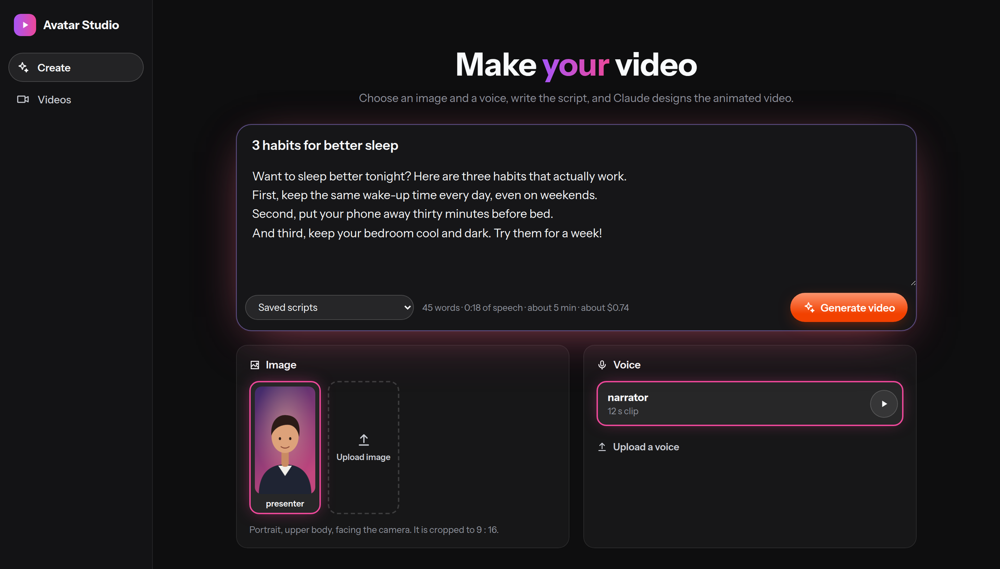

# Avatar Studio

Web app for the video pipeline: choose an image and a voice, type a script, press Generate, then watch
the progress and download the video. It uses Next.js and MongoDB, plus a worker that runs
`src/make_video.sh` one job at a time.



## Setup

Set up the pipeline first (see the [project README](../README.md)). Then, from the project root on a
Linux x64 server:

```bash
P=$(pwd)
# Node 24 into env/node
V=v24.22.3; mkdir -p $P/env/_dl && cd $P/env/_dl
curl -LO https://nodejs.org/dist/$V/node-$V-linux-x64.tar.xz && curl -LO https://nodejs.org/dist/$V/SHASUMS256.txt
grep " node-$V-linux-x64.tar.xz" SHASUMS256.txt | sha256sum -c - && tar -xJf node-$V-linux-x64.tar.xz && mv node-$V-linux-x64 $P/env/node
# MongoDB 8.0 into env/mongodb
M=mongodb-linux-x86_64-ubuntu2404-8.0.38
curl -LO https://fastdl.mongodb.org/linux/$M.tgz && curl -LO https://fastdl.mongodb.org/linux/$M.tgz.sha256
sha256sum -c $M.tgz.sha256 && tar -xzf $M.tgz && mv $M $P/env/mongodb && cd $P/env && rm -rf _dl
# Build
cd $P/webapp && export PATH=$P/env/node/bin:$P/env/mongodb/bin:$PATH
npm ci && cp .env.example .env.local && npm run build
```

## Run

```bash
bash webapp/scripts/start.sh     # MongoDB, web app, worker (detached)
bash webapp/scripts/status.sh
bash webapp/scripts/stop.sh
```

The app listens on 127.0.0.1:3100 only. Open it through an SSH tunnel at http://localhost:3100:

```bash
ssh -N -L 3100:127.0.0.1:3100 <user>@<server>
```

After changing code, run `npm run build` and restart the web app and worker.

## Mock mode

Set `MOCK=1` in `webapp/.env.local` (then restart) to try the app without API calls. It uses a separate
database and writes only to `webapp/data/mock/`. A script containing `FAIL_TEST` simulates a failure.

## Tests

Run these in mock mode:

```bash
node webapp/tests/e2e.mjs                       # API + worker
env/reel/bin/python webapp/tests/ui_check.py    # browser
(cd webapp && npx tsx tests/progress_check.ts)  # progress parser (any mode)
```

## Troubleshooting

| Problem | Fix |
|---|---|
| Videos stay "waiting" | `bash webapp/scripts/status.sh`; `bash webapp/scripts/start.sh worker`; see `logs/webapp/worker.log` |
| "Cannot reach the database" | `bash webapp/scripts/start.sh mongo`; see `logs/webapp/mongod.log` |
| Job failed with HTTP 402 | add OpenRouter credit, then press Retry |
| Any other failed job | full log in `logs/webapp/jobs/<name>.log` |
